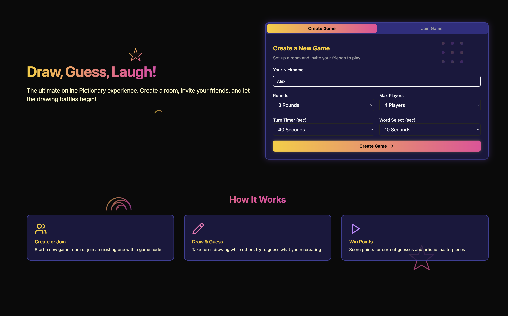
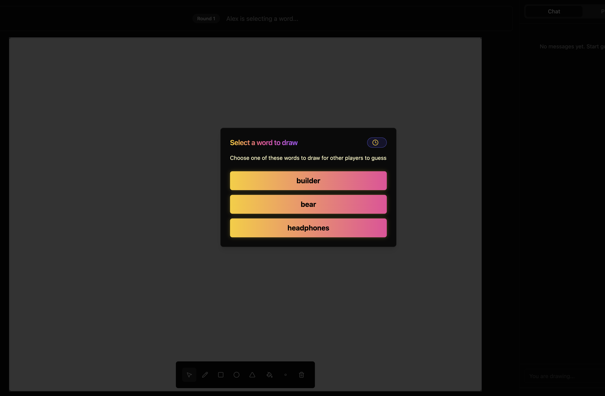
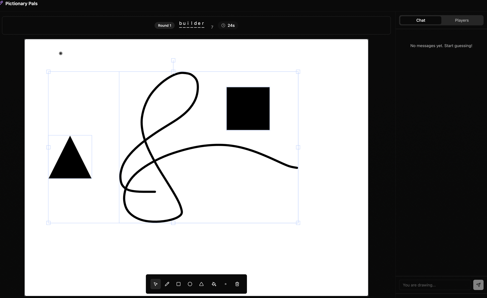

# Pictionary Multiplayer Game

A real-time multiplayer drawing and guessing game inspired by the classic Pictionary. Players take turns drawing a randomly selected word while others try to guess it before time runs out.

## Screenshots

### Landing Page


### Word Selection


### Active Drawing Turn


## Tech Stack

### Frontend
- **React** - UI framework
- **TypeScript**
- **Fabric.js** - Canvas manipulation library
- **TailwindCSS** - Utility-first CSS framework
- **Framer Motion** - Animations
- **React Router** - Navigation
- **Websockets** - Custom websocket hook

### [Backend - Now @github.com/AjStraight619/pictionary-serv](https://github.com/AjStraight619/pictionary-serv)
- **Go** 
- **Echo** - Web framework
- **Gorilla Websocket** - WebSocket implementation
- **Context** - For cancellation and cleanup
- **Mutex** - For thread-safe game state management

## Key Features

- 🖌️ **Real-time drawing** with synchronized canvas across all players
- 🔄 **Undo/redo functionality** with WebSocket synchronization
- 👥 **Player management** with reconnection grace period
- ⏱️ **Timer system** for game rounds, word selection, and turns
- 🎮 **Game state management** with proper cleanup and lifecycle
- 📱 **Responsive design** with 4:3 drawing canvas ratio
- 🎨 **Drawing tools** including pencil, shapes, and colors


### Prerequisites
- Node.js 20+ for frontend
- Go with automatic toolchain downloads enabled (backend specifies Go 1.23.8)
- Docker running locally

### Quick local development

From the project root:

```bash
bash start.sh
```

This starts PostgreSQL and Redis in Docker, seeds words into a fresh database,
and launches the backend and frontend at http://localhost:5173. First launch
downloads any missing dependencies. Ports 5432, 6379, 8080, and 5173 must be free.
Backend logs are in `.dev/backend.log`. Ctrl+C stops the app; database containers
and local data remain available for the next run. To stop the databases too:

```bash
docker stop pictionary-dev-postgres pictionary-dev-redis
```

Use a regular browser window and an incognito window for separate players.
The backend source must be present in `backend/` (it is ignored by this repo).
Restart the command after backend code changes; frontend changes reload automatically.

### Running the Frontend
```bash
cd frontend
npm install
npm run dev
```

### Running the Backend
```bash
cd backend
go run cmd/server/main.go
```

## Current Status & Roadmap

### Completed
- Core game mechanics (drawing, guessing, turn rotation)
- Real-time synchronization of drawing canvas
- Player management with reconnection handling
- Basic game loop (lobby, word selection, drawing, scoring)
- Canvas tools (pencil, shapes, colors)
- Responsive UI design
- Letter reveal logic

### In Progress
- Spectator mode
- Game statistics and leaderboards
- Mobile version (early development stage)

### Future Plans
- Custom word lists and room settings
- Voice chat integration
- Mobile-optimized interface
- Better diffing for game state updates

## Mobile Version

The mobile version of the game is currently in the early stages of development. It aims to provide a native-like experience for iOS and Android users while sharing core logic with the web version. Currently, basic functionality is being implemented with a focus on responsive design and touch interactions.

## Architecture Highlights

### Frontend
- **Custom hooks** for canvas management, WebSocket communication, game state
- **Component-based design** with separation of concerns
- **Responsive layout** that maintains drawing aspect ratio

### Backend
- **Concurrent game sessions** with proper resource cleanup
- **Event-driven architecture** for game state transitions
- **Connection management** with graceful reconnection handling
- **Context-based cancellation** for clean shutdown

## License

MIT License 
